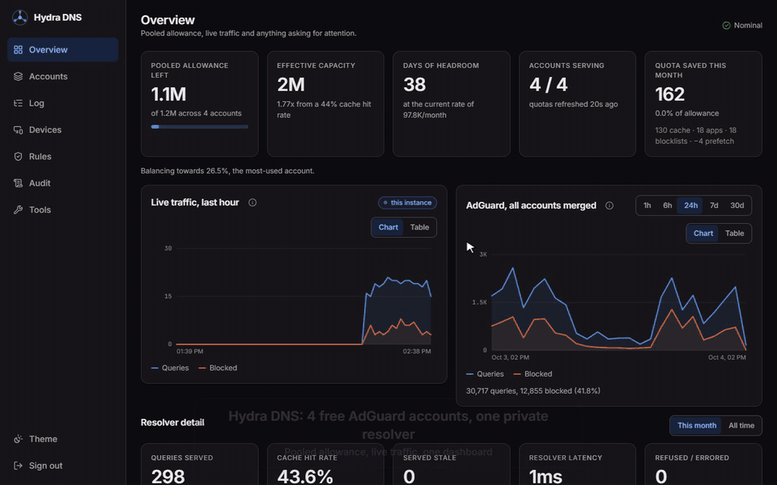

# Hydra DNS

**Pool several free AdGuard DNS accounts behind one private resolver, and manage every device
and filtering rule from one dashboard.**



A free AdGuard DNS account gives you a monthly query allowance and a few device slots. One
account runs out; several would be plenty, but nothing spreads traffic across them. Each
account's dashboard only shows its own slice. Each device belongs to exactly one account. And
every filter rule has to be typed into every account by hand.

Hydra sits in front of all of them. Your devices talk to Hydra over DoH, DoT or DoQ. Hydra
answers from its own cache where it can and forwards everything else to whichever account has
the most allowance left. It also writes one filtering policy to every account, so a rule behaves
the same no matter which account answers.

```
   your devices                    your server                         AdGuard DNS
┌──────────────┐              ┌────────────────────────┐        ┌──────────────────┐
│ Android      │── DoT 853 ──▶│  DoT / DoQ listener    │        │ account A  300k  │
│ laptop       │── DoH 443 ──▶│  DoH endpoint          │  DoH   │ account B  300k  │
│ iPhone       │              │      ↓ one resolver    │───────▶│ account C  300k  │
│ router       │              │  answer cache          │weighted│ account D  300k  │
└──────────────┘              │  quota-weighted pool   │by quota└──────────────────┘
                              │  per-device metrics    │                  │
┌──────────────┐◀── cookie ───│  dashboard API         │◀─────────────────┘ quota, stats,
│ dashboard    │     auth     └────────────────────────┘            OAuth2  query log,
│ (static site)│                    │           │                          filtering policy
└──────────────┘                    ▼           ▼
                    Postgres (optional)   fallback resolver
                    devices + metrics     (only when every account is spent)
```

## Contents

- [Features](#features)
- [How it works](#how-it-works)
- [What you need](#what-you-need)
- [Try it locally](#try-it-locally)
- [Deploy your own](#deploy-your-own)
- [Connect your devices](#connect-your-devices)
- [Day-to-day use](#day-to-day-use)
- [Upgrading](#upgrading)
- [Troubleshooting](#troubleshooting)
- [Security model](#security-model)
- [Limitations](#limitations)
- [Development](#development)
- [Contributing](#contributing)
- [License](#license)

Further reading: [`docs/configuration.md`](docs/configuration.md) (every environment variable),
[`docs/api.md`](docs/api.md) (every HTTP route), [`deploy/README.md`](deploy/README.md) (server
runbook).

## Features

**Resolver**

- **Account pooling.** *n* free accounts give you *n* times the monthly allowance. The default
  `balanced` strategy serves the least-used account first, so every account runs out on the same
  day instead of one dying weeks ahead of the rest.
- **DoH, DoT and DoQ** with one per-device token. Android Private DNS, iOS/macOS profiles,
  browsers and routers all work, and every query is attributed to the device it came from.
- **A cache that saves allowance.** Answer caching, coalescing of identical in-flight queries,
  prefetching of popular names, and a snapshot that survives a restart. Blocked answers are held
  longer than they are advertised, so retry storms cost nothing upstream while unblocking still
  takes effect within seconds.
- **It degrades instead of failing.** If every account is spent or unreachable, Hydra serves
  stale answers and then a fallback resolver (Quad9 by default). Devices keep resolving, the
  dashboard shows a red banner, and `/api/health` reports `degraded` so a monitor can alert.
- **Guards built in:** DNS-rebinding protection, CNAME-cloaked tracker blocking, local zones
  answered without spending allowance, and RFC 9462 resolver discovery.

**Filtering**

- **One pooled policy.** Rules, AdGuard blocklists, safe browsing and parental control are
  written to every account at once. Hydra watches for drift and offers to fix it.
- **Per-device rules,** temporary blocks, schedules ("block games after 22:00"), per-platform
  safe search, and a one-click pause.
- **Hydra's own blocklists:** subscribe to any hosts/AdBlock-style list. Hydra downloads it and
  enforces it locally, with presets and overlap stats.
- **App blocking by name** (YouTube, TikTok, Steam, …) from AdGuard's service catalog.

**Dashboard**

- An installable PWA with Overview, Accounts, Query log, Devices, Rules, Audit and Tools pages
  that works on phone and desktop.
- Add a device and scan its QR code to set it up. Add an AdGuard account from the UI with no
  restart.
- Merged stats and query logs across every account, a "new domains" feed with
  suspicious-name scoring, and quiet-device alerts.
- Web Push alerts and a weekly digest, an audit log, policy versioning with rollback,
  backup/restore, Prometheus `/metrics`, and machine tokens for automation.

## How it works

Each AdGuard account contributes one DNS server and one device. Hydra creates and owns that
device and uses it purely as capacity. Your real devices live in Hydra's registry instead.

Every device has a **token** derived from `HYDRA_RESOLVER_SECRET`. The same token appears in all
three addresses:

```
DoH   https://api.dns.example.com/dns-query/<token>     browsers, Apple, apps
DoT   <token>.dot.example.com                           Android Private DNS, routers
DoQ   quic://<token>.dot.example.com                    AdGuard apps, 853/udp
```

All three end at Hydra, so they share one cache and one pool, they show up per-device in the
log, and deleting a device revokes all three at once. The DoT hostname *is* the credential (TLS
has nothing but SNI to carry identity), which is why it is a random token and not
`phone.dot.example.com`.

For every query Hydra checks, in order: the device's own rules and schedules, Hydra's
blocklists and app blocks, local rewrites and zones, then the cache. Only a miss is forwarded
upstream, to the account picked by the pooling strategy.

## What you need

| | |
|---|---|
| **AdGuard DNS accounts** | Two or more free accounts at [adguard-dns.io](https://adguard-dns.io). **Two-factor authentication must be off**, because Hydra signs in with the OAuth password grant. |
| **A Linux server** | Ubuntu 24.04 (Python 3.11+ is required, and 22.04 ships 3.10), a public IPv4 address, and ports 443/tcp, 853/tcp and 853/udp reachable. 1 GB of RAM is enough. Any VPS works, including the Oracle Cloud Always Free micro instance. |
| **A domain** | You will use three names under it, for example `api.dns.example.com`, `dot.example.com` and `*.dot.example.com`. |
| **A wildcard TLS certificate** | `install.sh` issues one from Let's Encrypt using a **Cloudflare** DNS API token. With another DNS provider, issue it yourself first (see [deploy/README.md](deploy/README.md#using-a-dns-provider-other-than-cloudflare)). |
| **A static host** for the dashboard | Netlify (config included), Cloudflare Pages, GitHub Pages, Vercel, S3, or nginx on the same server. |
| *Optional:* **Supabase** | A free project gives you an editable device registry and stats, audit and query history that survive restarts. Without it, devices come from an env var and the dashboard can't add or remove them. |

## Try it locally

You can run the whole stack on your laptop to see the dashboard. Local mode runs DoH only, with
no TLS.

```bash
git clone https://github.com/anubhavlal07/hydra.git
cd hydra

python -m venv .venv
source .venv/bin/activate          # Windows: .venv\Scripts\activate
pip install -r requirements-dev.txt

cp .env.example .env
```

Edit `.env` and set at least these values:

```dotenv
HYDRA_ADGUARD_ACCOUNTS=[{"label":"main","username":"you@example.com","password":"…"}]
HYDRA_DASHBOARD_PASSWORD=pick-something
HYDRA_RESOLVER_SECRET=<python -c "import secrets; print(secrets.token_urlsafe(32))">
HYDRA_SESSION_SECRET=<another one>
```

To try it without AdGuard credentials, give an account a `doh_url` and Hydra will forward to it
directly (only the quota figures go missing):

```dotenv
HYDRA_ADGUARD_ACCOUNTS=[{"label":"test","username":"x","password":"x","doh_url":"https://dns.quad9.net/dns-query"}]
```

Start the API and resolver:

```bash
set -a; source .env; set +a        # or export the variables another way
PYTHONPATH=src python -m hydra_dns.serve     # http://localhost:8080
```

In a second terminal, start the dashboard:

```bash
cd dashboard
echo "NEXT_PUBLIC_API_BASE=http://localhost:8080" > .env.local
npm install
npm run dev                         # http://localhost:3200
```

Sign in with `HYDRA_DASHBOARD_PASSWORD`. To send a query through it, copy a device's DoH URL
from the Devices page:

```bash
curl -s "http://localhost:8080/dns-query/<token>?name=example.com&type=A"
```

## Deploy your own

The steps below use these example names. Replace `example.com` with your own domain
everywhere.

| Purpose | Example |
|---|---|
| Dashboard | `https://dns.example.com` |
| API and DoH | `api.dns.example.com` |
| DoT/DoQ base | `dot.example.com` (devices use `<token>.dot.example.com`) |

### 1. Create the AdGuard accounts

Sign up for two or more free accounts at [adguard-dns.io](https://adguard-dns.io), each with its
own email address, and leave 2FA off. You don't need to create devices or servers in them.
Hydra creates its own `Hydra DNS` device in each account the first time it signs in.

### 2. Create the server

Any Ubuntu 24.04 VPS with a public IPv4 address works. In your provider's firewall (security
group, NSG, firewall rules), allow inbound **22/tcp, 443/tcp, 853/tcp and 853/udp**. 853/udp is
DoQ and needs its own rule.

> On Oracle Cloud Always Free, pick **Canonical Ubuntu 24.04** (not Minimal) on the
> `VM.Standard.E2.1.Micro` shape, and add the ports to the instance's Network Security Group or
> the subnet's Security List.

### 3. Point DNS at the server

Create three records. All of them must be **DNS-only**: on Cloudflare that means a grey cloud,
not orange. A proxy breaks DoT completely and would terminate HTTPS where the certificate isn't.

| Name | Type | Value |
|---|---|---|
| `api.dns.example.com` | A | server IP |
| `dot.example.com` | A | server IP |
| `*.dot.example.com` | A | server IP |

### 4. Get a DNS API token for the certificate

A wildcard certificate needs a DNS-01 challenge. On Cloudflare, go to **My Profile → API Tokens
→ Create Token → Edit zone DNS** and scope it to your zone. Copy the token.

### 5. Run the installer

```bash
ssh ubuntu@<server-ip>
git clone https://github.com/anubhavlal07/hydra.git
cd hydra

sudo HYDRA_DOMAIN=dot.example.com \
     HYDRA_API_DOMAIN=api.dns.example.com \
     HYDRA_DASHBOARD_ORIGIN=https://dns.example.com \
     HYDRA_COOKIE_DOMAIN=.example.com \
     CF_API_TOKEN='<token from step 4>' \
     bash deploy/install.sh
```

The installer:

- Installs Python, certbot and a service user.
- Builds a virtualenv in `/opt/hydra-dns`.
- Issues the certificate and installs a renewal hook.
- Writes `/etc/hydra-dns/hydra.env`, with both secrets already generated.
- Opens the host firewall (`ufw` or iptables).
- Installs the hardened `hydra-dns` systemd unit.
- On 1 GB machines, it also adds swap and caps the journal.

It stops before starting the service, because your AdGuard credentials aren't filled in yet.

### 6. Fill in the secrets and start

```bash
sudo nano /etc/hydra-dns/hydra.env
```

Set the following:

```dotenv
HYDRA_DASHBOARD_PASSWORD=<what you will type to sign in>
HYDRA_ADGUARD_ACCOUNTS=[{"label":"alpha","username":"a@example.com","password":"…"},{"label":"bravo","username":"b@example.com","password":"…"}]
```

Then start it and check it:

```bash
sudo systemctl restart hydra-dns
sudo systemctl status hydra-dns
curl https://api.dns.example.com/api/health      # {"status":"ok",...}
```

> **Back up `HYDRA_RESOLVER_SECRET`.** Every device address is derived from it. Lose it or
> change it, and every phone and router has to be set up again.

### 7. Deploy the dashboard

The dashboard is a static Next.js export. It needs one build-time variable, which points at your
API:

```
NEXT_PUBLIC_API_BASE=https://api.dns.example.com
```

**Netlify** (config included): import the repo, add the variable above under *Site settings →
Environment variables*, and in `netlify.toml` replace `https://api.dns.example.com` in the
`Content-Security-Policy` line with your API URL. The build settings (`base = "dashboard"`,
publish `out`) are already in the file. Add `dns.example.com` as the site's custom domain.

**Any other static host:**

```bash
cd dashboard
npm ci
NEXT_PUBLIC_API_BASE=https://api.dns.example.com npm run build
# upload dashboard/out/
```

Configure the host to:

1. Fall back to `/index.html` for unknown paths (SPA routing).
2. Never cache `/sw.js` or `/manifest.webmanifest`.
3. Ideally, send the security headers listed in `netlify.toml`.

The dashboard's origin must match `HYDRA_CORS_ORIGINS`, and the dashboard and API hosts must
share the parent domain in `HYDRA_COOKIE_DOMAIN`, or sign-in won't stick.

### 8. (Optional) Add Supabase for an editable registry and history

1. Create a free project at [supabase.com](https://supabase.com).
2. In the SQL editor, run every file in `supabase/` **in order**, from `001` to `017`.
3. Insert a long random secret. Hydra presents it on every call, and the database functions
   refuse anything without it:

   ```sql
   insert into hydra.config (key, value) values ('api_secret', '<long random string>');
   ```

4. Add the following to `/etc/hydra-dns/hydra.env`, then restart:

   ```dotenv
   HYDRA_STORE_URL=https://<project-ref>.supabase.co
   HYDRA_STORE_KEY=<publishable / anon key>
   HYDRA_STORE_SECRET=<the secret from step 3>
   HYDRA_STORE_SEED=true            # first start only; remove it afterwards
   HYDRA_METRICS_PERSIST=true       # keep stats across restarts
   HYDRA_AUDIT_PERSIST=true         # keep the audit log
   ```

The publishable key grants nothing on its own. Every table sits in a private `hydra` schema
behind `SECURITY DEFINER` functions that check the secret.

### 9. Sign in and finish setup

1. Open `https://dns.example.com` and sign in.
2. Open **Accounts** to check every account is signed in and showing quota.
3. Open **Rules** and press **Sync accounts** so every account carries the same policy (new
   accounts start on AdGuard's defaults).
4. Open **Devices** and add your first device.
5. Optional: point an uptime monitor at `https://api.dns.example.com/api/health` with the
   keyword `"status":"ok"`, and at `/api/status` with `"state":"nominal"` for early warnings
   (low quota, failed sign-in, an expiring certificate).

## Connect your devices

Every device on the **Devices** page has a QR code and a setup page
(`https://api.dns.example.com/setup/<token>`) you can open on the device itself.

| Platform | How |
|---|---|
| **Android 9+** | Settings → Network & internet → **Private DNS** → *Private DNS provider hostname* → `<token>.dot.example.com` |
| **iPhone / iPad / Mac** | Open the setup page on the device and install the configuration profile (Settings → General → VPN & Device Management) |
| **Chrome / Edge / Firefox** | Secure DNS → custom provider → `https://api.dns.example.com/dns-query/<token>` |
| **AdGuard apps** | `quic://<token>.dot.example.com` (DoQ) |
| **Router / whole LAN** | Run [`dnsproxy`](https://github.com/AdguardTeam/dnsproxy) on an always-on machine: `dnsproxy -l 0.0.0.0 -p 53 -u tls://<token>.dot.example.com`, then hand that machine's IP out via DHCP |
| **Windows 11** | Native DoH needs a fixed server IP, so use the browser setting or `dnsproxy` |

Within a few seconds the device's queries show up in the dashboard's query log under its name.

## Day-to-day use

You can do almost everything from the dashboard, and none of it needs a restart:

- **Add or revoke a device:** Devices. Deleting a device revokes all three of its addresses at
  once.
- **Block or allow a domain:** press Block/Allow on any row in the query log, or open the domain
  sheet for one domain across every device.
- **Add capacity:** Accounts → Add. Hydra signs in before saving, then adds the account to the
  pool live. Afterwards, press **Sync accounts** on Rules.
- **Pause filtering for one device:** open the device and pick a duration. The pause lapses on
  its own.
- **Back up:** Tools → Backup and restore downloads devices, rules, rewrites, blocklist settings and
  (optionally) accounts in one file.

Server-side commands:

```bash
sudo systemctl reload hydra-dns        # re-read the certificate, no outage
sudo systemctl restart hydra-dns       # after editing hydra.env
sudo journalctl -u hydra-dns -f        # logs
sudo certbot renew --dry-run           # prove renewal works
```

## Upgrading

```bash
cd /opt/hydra-dns && sudo bash deploy/install.sh
```

The installer is idempotent. It pulls the latest `main`, rebuilds the virtualenv, keeps every
value already in `hydra.env`, and appends only settings that are new. If a release changed
`install.sh` itself, run it twice: bash keeps executing the copy it started with. If you use
Supabase, apply any new `supabase/NNN_*.sql` files before restarting.

## Troubleshooting

| Symptom | Likely cause |
|---|---|
| Works on the server, **times out** from outside | Your cloud firewall is dropping the port. A *refused* connection means the service is down; a *timeout* means a firewall. Check both the provider firewall and the host firewall. |
| Android says "Couldn't connect" to Private DNS | `*.dot` is proxied (orange cloud), 853/tcp is blocked, or the certificate doesn't cover `*.dot.example.com`. Test with `kdig +tls @<token>.dot.example.com example.com`. |
| Dashboard says it can't reach the API | `NEXT_PUBLIC_API_BASE` is wrong at build time, `HYDRA_CORS_ORIGINS` doesn't match the dashboard origin exactly, or the CSP `connect-src` still points at `example.com`. |
| Sign-in succeeds, then shows signed out | `HYDRA_COOKIE_DOMAIN` isn't a parent of both the dashboard and API hosts. |
| An account shows "cannot sign in" | Wrong password, or 2FA is on for that AdGuard account. |
| `/api/health` says `degraded` | No account can answer, either because all of them are spent or because AdGuard is unreachable. Devices still resolve through the fallback, **unfiltered**. Check Accounts. |
| A site is blocked on some lookups but not others | Accounts disagree on policy. Press **Sync accounts** on Rules. |
| Small queries work, large ones hang | ICMP "fragmentation needed" (type 3 code 4) is blocked. Allow it in the cloud firewall. |

[`deploy/README.md`](deploy/README.md) has more operational detail.

## Security model

- **Device tokens are the credential.** They are HMAC-derived from `HYDRA_RESOLVER_SECRET`.
  Hydra never stores them, so rotating that secret revokes every device at once.
- **The dashboard** uses one password, a signed `HttpOnly` cookie, rate-limited login and HSTS.
  For automation, mint scoped **machine tokens** from Tools. Only their hash is stored.
- **Public endpoints** (`/api/health`, `/api/status`) return a single word. Detail needs a
  session.
- **AdGuard passwords** sit in `/etc/hydra-dns/hydra.env` and
  `/var/lib/hydra-dns/accounts.json` (both 0600, service-owned). They are deliberately never
  sent to Postgres.
- **The service** runs as an unprivileged user under a hardened systemd unit
  (`ProtectSystem=strict`, `NoNewPrivileges`, capability limited to binding low ports).
- **Hydra refuses queries without a token.** It is not an open resolver unless you set
  `HYDRA_ALLOW_ANONYMOUS=true`. Don't.

To report a vulnerability, open a private security advisory on GitHub rather than a public
issue.

## Limitations

- Hydra forwards **from your server**. AdGuard sees the server's IP, not your devices', so
  AdGuard-side per-client rules (`$client=…`) and AdGuard's own per-device stats don't apply.
  Hydra's per-device rules and stats replace them.
- AdGuard accounts with 2FA can't be pooled.
- One instance holds the cache, counters and rate limits in memory. Running two instances gives
  you two of everything.
- Using several free accounts is your decision. Read AdGuard DNS's terms of service and make
  sure your use complies with them.

## Development

```bash
pip install -r requirements-dev.txt
python -m pytest                          # resolver tests
python -m ruff check src tests
python -m ruff format --check src tests

cd dashboard
npm ci
npx tsc --noEmit && npm run lint && npm run test && npm run build
```

`bash scripts/check.sh` runs all of it, and GitHub Actions runs the same checks on every push
and pull request.

Layout:

```
src/hydra_dns/          FastAPI app, resolver, AdGuard client and pool manager
  resolver/             DoH, DoT, DoQ listeners, cache, upstream selection, metrics
  adguard/              OAuth, management API client, policy sync
  api/                  dashboard API routes
dashboard/              Next.js static dashboard (PWA)
supabase/               optional Postgres schema, applied in order
deploy/                 installer, systemd unit, certificate renewal hook
tests/                  pytest suite
```

## Contributing

Issues and pull requests are welcome. Before opening a PR:

1. Run `bash scripts/check.sh`. CI runs the same checks.
2. Add tests for behaviour changes. The suite deliberately covers the failure paths (an empty
   pool, an unreachable registry, an expired certificate), so please keep it that way.
3. If you add an HTTP method to a route, add it to `CORS_METHODS` in `src/hydra_dns/main.py`.
   `tests/test_security.py` checks this.
4. Keep the resolver path lean. The process *is* the resolver, so heavy dependencies and slow
   startup cost DNS availability.

## License

[MIT](LICENSE)
